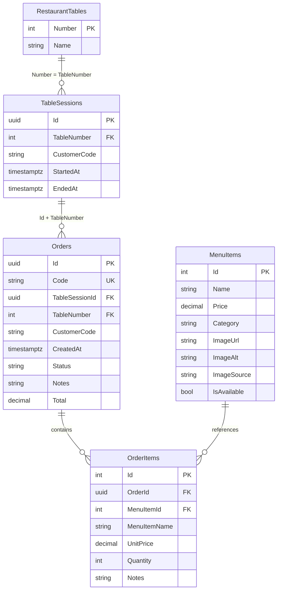

# Database tuần 2

PostgreSQL 17, EF Core/Npgsql 10. DbContext thuộc Order.Api, chưa có service khác dùng
nên chưa tách project chung. Migration thực sự tạo schema; không dùng EnsureCreated.

- Số bàn là khóa nghiệp vụ, không tự tăng; seed 1–5. Lượt dùng bàn có UUID riêng,
  mã khách và thời điểm; không dùng số bàn một mình để phân biệt các lượt.
- Đơn lưu mã lượt, số bàn và mã khách. FK ghép tới `(TableSessionId, TableNumber)`
  buộc số bàn trong đơn khớp lượt. CustomerCode trong đơn là bản chụp; tuần 3 server
  sẽ lấy từ lượt khách, không tin giá trị client. Mã khách chưa phải thông tin phân quyền.
- OrderItem giữ tên/giá lúc đặt, không lấy lại tên/giá hiện tại khi xem lịch sử.
  FK món dùng Restrict để không xóa món đã được tham chiếu; ngừng bán bằng IsAvailable.
- Giá/đơn giá/tổng: C# decimal, PostgreSQL numeric(18,2), không âm. Số lượng > 0.
  Thời gian dùng DateTimeOffset UTC/timestamp with time zone; kết thúc lượt không trước bắt đầu.
- Trạng thái lưu chuỗi Pending/Preparing/Ready/Cancelled có check constraint.
  Mặc định Pending ở model C#; tuần 3 API tạo đơn phải chủ động dùng Pending.
  Check constraint chưa kiểm tra luồng chuyển trạng thái; cập nhật cạnh tranh sẽ triển khai tuần 6.
- Xóa đơn cascade chi tiết; không xóa lượt/bàn đang có tham chiếu. Không có endpoint xóa ở tuần này.
- Mã món seed 1–10, sequence món thêm mới từ 1000; seed chỉ bổ sung mã thiếu, không
  ghi đè dữ liệu đã chỉnh. Migration lock bảo vệ khi hai lệnh seed cùng chạy.
- Chưa tạo lượt khách hoặc đơn mẫu trong seed. Chưa có nghiệp vụ tạo đơn; tuần 3 sẽ
  kiểm tra giỏ/món đang bán, tính tổng server và lưu đơn/chi tiết trong transaction.

Giới hạn hiện tại: chưa ràng buộc một lượt mở duy nhất trên mỗi bàn, chưa có xác thực,
chưa đối chiếu Total với tổng chi tiết bằng DB trigger. Các quy tắc nghiệp vụ cần thiết
sẽ đặt ở server khi có API tương ứng; không coi schema là phần thay thế validation.
