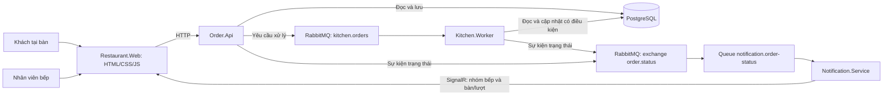
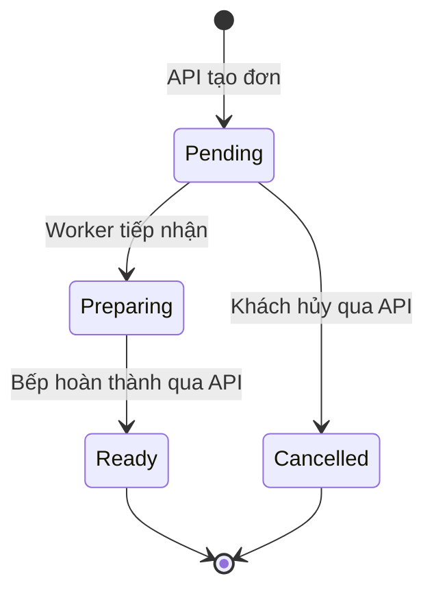

# A. Yêu cầu và kiến trúc Bếp Nhà

## Nguồn và phạm vi

Đối chiếu đề 04 `04-he-thong-dat-mon-va-xu-ly-bep.md`, `HUONG-DAN-CHUNG.md` và `AGENTS.md`.
Đề/hướng dẫn chung yêu cầu C#/.NET 10, Minimal API, RabbitMQ, database, realtime,
service độc lập, Docker, cấu hình môi trường, logging, phục hồi, GitHub và báo cáo.
Đó là yêu cầu sản phẩm cuối, không phải toàn bộ chức năng của tuần 1.

Lựa chọn dự án: một quán ăn, khoảng 10 món và 5 bàn mẫu; PostgreSQL/EF Core;
HTML/CSS/JavaScript do Restaurant.Web phục vụ, SignalR cho realtime.
Chưa có thanh toán, nhiều chi nhánh hoặc đăng nhập/phân quyền. Mã lượt bàn phục vụ
demo và lọc dữ liệu, chưa phải cơ chế xác thực quyền truy cập.

## Tác nhân

| Tác nhân | Chức năng sản phẩm cuối |
|---|---|
| Khách tại bàn | Xem món, giỏ/tăng giảm/xóa món, ghi chú, gửi đơn, tra cứu theo bàn/lượt, hủy Pending |
| Nhân viên bếp | Xem đơn/món/số lượng/ghi chú theo trạng thái; đánh dấu Preparing thành Ready |
| Worker tự động | Tiếp nhận Pending từ queue và chuyển Preparing |

Mỗi lần gửi tạo một đơn mới; khách được gọi thêm. Màn hình xác định số bàn và mã
khách/lượt dùng bàn; có cách bắt đầu lượt mới trong demo.
Giao diện nền kem/trắng, xanh lá đậm, cam cho Preparing, chữ Việt và nút dễ chạm.
Khóa nút gửi trong request; nếu mất kết nối khiến kết quả chưa rõ thì tra cứu trước khi gửi lại.

## Dữ liệu

| Dữ liệu | Thuộc tính chính |
|---|---|
| Món | Mã, tên, danh mục, ảnh/nguồn ảnh, giá decimal, đang bán |
| Đơn | Mã, bàn, mã khách/lượt, thời điểm UTC, ghi chú, trạng thái, tổng tiền |
| Chi tiết | Mã món, tên và đơn giá tại lúc đặt, số lượng |
| Thông điệp | MessageId, OrderId, thời điểm; sự kiện có trạng thái và nhóm bàn/lượt |

Server kiểm tra giỏ có món, món tồn tại/đang bán, số lượng dương; tính tiền bằng
decimal từ giá database. Lưu đơn/chi tiết nguyên vẹn trong transaction. Chụp tên/giá
tại lúc đặt để giữ đúng lịch sử. API và Worker truy cập chung PostgreSQL theo sơ đồ đề.

## Kiến trúc đích

Trình duyệt tải trang từ Restaurant.Web, gọi Order.Api và kết nối SignalR trực tiếp
tới Notification.Service. CORS và hub được bổ sung khi có client thực.
Tên queue/exchange là dự kiến, chốt hợp đồng khi triển khai messaging.
Tuần 1 chưa có hợp đồng dùng chung nên không tạo project contracts.

## Luồng và phục hồi dự kiến

1. API kiểm tra và lưu đơn Pending, publish yêu cầu xử lý.
2. Một Worker xử lý tuần tự, đọc lại DB và chuyển Pending → Preparing có điều kiện.
3. Worker phát sự kiện, ack sau xử lý thành công. Queue bền vững, thông điệp persistent.
4. Bếp hoàn thành/khách hủy qua API; thành phần thực hiện đổi trạng thái phát sự kiện.
5. Notification nhận sự kiện qua queue riêng, gửi SignalR đúng nhóm bếp và bàn/lượt.
6. Client tải dữ liệu mới từ API khi nhận sự kiện; reconnect đăng ký lại nhóm và tải lại đơn,
   tránh sự kiện cũ làm lùi trạng thái.

Queue yêu cầu tách queue sự kiện. Giao lại thông điệp/thao tác lặp phải nhất quán.
Log mã đơn, thao tác, kết quả và lỗi xuyên service. Đến tuần 8 phải hoàn thiện khoảng
trống DB lưu thành công nhưng publish thất bại (cân nhắc outbox nhỏ), thử ngắt broker
rồi khôi phục; bộ khung tuần 1 chưa có bảo đảm phục hồi này.

## Chuyển trạng thái

Ready/Cancelled kết thúc. Không hủy Preparing hoặc hoàn thành Pending. Khi hủy và
tiếp nhận cạnh tranh, cập nhật có điều kiện để chỉ một thao tác thắng. Cần kiểm tra
đơn không tồn tại, dữ liệu sai, thao tác lặp và cạnh tranh khi triển khai nghiệp vụ.

## API đích

| Method | Route | Chức năng | Tuần |
|---|---|---|---|
| GET | /menu | Thực đơn từ DB | 2 |
| POST | /orders | Tạo Pending | 3 |
| GET | /orders/{id} | Chi tiết/trạng thái | 3 |
| GET | /orders | Danh sách, bổ sung lọc bàn/lượt | 3–5 |

Endpoint hủy/hoàn thành và phản hồi lỗi được định nghĩa khi triển khai tuần 6.
Tuần 1 chỉ có endpoint kiểm tra. Tuần 2 đã có GET /menu từ PostgreSQL,
migration/seed và model dữ liệu; xem README và database-tuan-2.md.

## Triển khai và lộ trình

Mỗi service .NET sẽ có Dockerfile riêng; docker-compose.yml ghép bốn ứng dụng,
PostgreSQL và RabbitMQ ở tuần 8. Tuần 2 đã có Compose cho riêng PostgreSQL có volume;
các service .NET vẫn chạy trên host. Container gọi qua Docker network/service name
(order-api, postgres, rabbitmq), không dùng localhost cho container khác.
Trình duyệt dùng URL host được publish; URL nội bộ khác URL trình duyệt.
Connection string, broker, URL và port nằm trong cấu hình môi trường.

| Tuần | Mục tiêu |
|---|---|
| 1 | Phân tích, solution, bốn project chạy độc lập |
| 2 | DB, EF Core, migration, seed, GET /menu |
| 3 | Tạo/đọc đơn và validation |
| 4 | RabbitMQ và Worker |
| 5 | Màn hình khách, giỏ và đơn theo bàn/lượt |
| 6 | Màn hình bếp, hoàn thành/hủy và đồng thời |
| 7 | Sự kiện, SignalR, reconnect |
| 8 | Docker, phục hồi và kiểm thử tích hợp |
| 9 | Rà yêu cầu, clone mới, báo cáo, README, demo |
